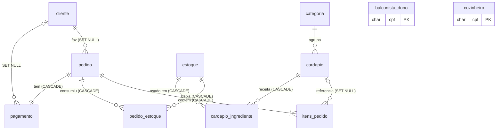

# 01 · Auditoria do sistema de referência (PHP)

Repositório analisado: [SPTulio/cali-burger](https://github.com/SPTulio/cali-burger), commit `90166ce` (clonado em 16/10/2026).
Foram lidos **todos** os arquivos de código: `app/*.php`, `app/partials/*`, as 40 páginas de `public/`, `public/js/confirmacao.js`, `database/01_schema.sql`, `database/02_dados_exemplo.sql`, `docker-compose.yml`, os testes `tests/*.py` e o workflow de CI. As capturas de tela em `docs/img` foram usadas como referência de fluxo.

Legenda usada neste documento:

- ✅ **Confirmado no código** — comportamento lido diretamente na implementação (arquivo citado).
- 🔶 **Hipótese** — inferência a partir de nomes, dados de exemplo ou ausência de código.

---

## 1. Resumo do funcionamento

Sistema web de pedidos de uma hamburgueria (**Cali Burger**) em PHP 8 sem framework, com páginas renderizadas no servidor e MySQL. Há três perfis com áreas e logins próprios:

| Perfil | Login | Área inicial |
| --- | --- | --- |
| Cliente | usuário + senha (`valida_login.php`) | `cardapio_cliente.php` |
| Balconista/dono | CPF + senha (`valida_login_balconista.php`) | `pedidos.php` |
| Cozinheiro | CPF + senha (`valida_login_cozinheiro.php`) | `pedidos_cozinheiro.php` |

Fluxo principal ✅ (`app/pedidos.php`): o cliente monta o carrinho (sessão), revisa o endereço, “paga” via PIX simulado e o pedido é criado **em transação** com baixa de estoque pela receita de cada item. O balconista aceita ou recusa; a cozinha marca como “saiu para entrega”; o cliente confirma o recebimento. Cancelamento/recusa devolvem ao estoque exatamente o que foi consumido.

## 2. Inventário de funcionalidades

| # | Funcionalidade | Perfil | Origem (✅) |
| --- | --- | --- | --- |
| F01 | Cadastro de cliente (usuário, nome, senha+confirmação, e-mail, CPF, nascimento, endereço) | Público | `cadastro.php` |
| F02 | Login de cliente por usuário | Público | `login.php`, `valida_login.php` |
| F03 | Login de funcionário por CPF (balconista / cozinheiro) | Público | `login_*.php`, `auth.php::login_funcionario` |
| F04 | Bloqueio após 5 falhas de login por 5 min | Todos | `auth.php` |
| F05 | Migração transparente de senha legada em texto puro → bcrypt | Todos | `auth.php::conferir_senha` |
| F06 | Logout | Todos | `sair.php` |
| F07 | Cardápio público com filtro por categoria e disponibilidade (Esgotado / Últimas N) | Público/Cliente | `cardapio_cliente.php`, `cardapio.php::listar_cardapio` |
| F08 | Carrinho: adicionar (soma), alterar quantidade, observação por item, remover, limite de 20 por item | Público/Cliente | `carrinho.php` |
| F09 | Revisão do pedido: endereço de entrega + resumo + PIX ilustrativo | Cliente | `pagamento.php` |
| F10 | Criação do pedido com baixa de estoque transacional e registro de pagamento PIX | Cliente | `pedido_sucesso.php`, `pedidos.php::criar_pedido` |
| F11 | Tela de sucesso com nº do pedido | Cliente | `pedido_sucesso.php` |
| F12 | Meus pedidos com filtro por status e data inicial; cancelar (aguardando) e “recebi” (a caminho) | Cliente | `meus_pedidos.php` |
| F13 | Perfil do cliente: ver, editar dados, trocar senha (exige a atual), alterar endereço, excluir conta | Cliente | `perfil_cliente.php`, `editar_cliente.php`, `editar_endereco.php`, `deleta_usuario.php` |
| F14 | Pedidos do balconista: aba “Aguardando aceitação” (com contador) e “Todos” com filtro de status e data/hora | Balconista | `pedidos.php` |
| F15 | Aceitar / recusar pedido; enviar para entrega | Balconista | `atualizar_status_pedido.php` |
| F16 | Contador de pedidos aguardando no menu | Balconista | `partials/menu_balconista.php` |
| F17 | Gestão do cardápio: listar, criar, editar (com receita e imagem), excluir | Balconista | `cardapio.php`, `adiciona_item_cardapio.php`, `editar_cardapio.php` |
| F18 | Upload seguro de imagem (PNG/JPG/WebP, 2 MB, conteúdo real, nome aleatório) | Balconista | `cardapio.php::salvar_imagem_enviada` |
| F19 | Estoque: listar com “usado em N itens” e situação (OK / baixo / em falta); adicionar (soma se já existir); editar nome/quantidade; excluir (retira das receitas) | Balconista | `estoque.php`, `adiciona_ingrediente.php`, `editar_ingrediente.php`, `deleta_ingrediente.php` |
| F20 | Relatório por período: faturamento, nº de pedidos, itens vendidos, ticket médio; vendas por dia e produto; ingredientes usados; ingredientes a comprar | Balconista | `relatorio.php` |
| F21 | Equipe: listar balconistas e cozinheiros; cadastrar; excluir (não exclui o último balconista) | Balconista | `main.php`, `delete_*.php`, `funcionarios.php` |
| F22 | Perfil do funcionário: ver, editar os próprios dados, trocar senha | Balconista/Cozinheiro | `perfil_*.php`, `editar_*.php` |
| F23 | Balconista exclui a própria conta (logout imediato) | Balconista | `perfil_balconista_dono.php`, `delete_balconista_dono.php` |
| F24 | Fila da cozinha (pedidos em preparação, mais antigos primeiro, recarrega a cada 30 s) e “Pronto: enviar para entrega” | Cozinheiro | `pedidos_cozinheiro.php` |
| F25 | Cardápio somente leitura para a cozinha (ingredientes e disponibilidade) | Cozinheiro | `cardapio_cozinheiro.php` |
| F26 | Confirmação modal para ações destrutivas/importantes | Todos | `js/confirmacao.js` |
| F27 | Mensagens flash de sucesso/erro (PRG) | Todos | `helpers.php::mensagem` |

## 3. Telas e fluxos de navegação

```text
Público
  index.php ──► (logado? área do perfil : cardapio_cliente.php)
  login.php ──► valida_login.php ──► voltar_para | cardapio_cliente.php
  cadastro.php ──► login.php (mensagem de sucesso)
  login_balconista.php / login_cozinheiro.php ──► pedidos.php / pedidos_cozinheiro.php

Cliente
  cardapio_cliente.php [?categoria] ──POST adicionar──► carrinho.php ──► cardapio_cliente.php (mantém categoria)
  carrinho.php ──atualizar/remover──► carrinho.php
             └──finalizar──► pagamento.php (exige login; guarda "voltar_para")
  pagamento.php ──alterar endereço──► editar_endereco.php?voltar=pagamento ──► pagamento.php
             └──POST confirmar──► pedido_sucesso.php ──(PRG)──► pedido_sucesso.php?pedido=N
  meus_pedidos.php [status_filter, date_filter] ──POST cancelar/concluir──► atualizar_status_pedido.php ──► meus_pedidos.php
  perfil_cliente.php ──► editar_cliente.php | editar_endereco.php | deleta_usuario.php ──► login.php

Balconista
  pedidos.php [visao=aguardando|todos, status_filter, date_filter] ──aceitar/recusar/confirmar──► (volta com filtros)
  cardapio.php ──► adiciona_item_cardapio.php | editar_cardapio.php?id | excluir (POST)
  estoque.php ──► adiciona_ingrediente.php | editar_ingrediente.php?id | deleta_ingrediente.php
  relatorio.php [start_date, end_date]
  main.php (Equipe) ──► cadastrar (POST) | delete_balconista_dono.php | delete_cozinheiro.php
  perfil_balconista_dono.php ──► editar_balconista_dono.php | excluir conta

Cozinheiro
  pedidos_cozinheiro.php (auto-refresh 30 s) ──confirmar──► pedidos_cozinheiro.php
  cardapio_cozinheiro.php
  perfil_cozinheiro.php ──► editar_cozinheiro.php
```

Estados de interface observados ✅: tabela vazia com mensagem (“Nenhum pedido encontrado. Que tal pedir agora?”), carrinho vazio com CTA, item esgotado com opacidade reduzida, erros de formulário em lista no topo, mensagens flash. 🔶 Não há estados de carregamento (páginas são síncronas).

## 4. Regras de negócio identificadas (✅ confirmadas no código)

**Pedidos — máquina de estados** (`app/pedidos.php::ACOES_PEDIDO`)

| Ação | Quem | De | Para | Efeito extra |
| --- | --- | --- | --- | --- |
| aceitar | balconista | Aguardando aceitação | Em preparação | — |
| recusar | balconista | Aguardando aceitação | Cancelado/recusado | devolve estoque |
| confirmar (“saiu para entrega”) | cozinheiro **ou** balconista | Em preparação | A caminho | — |
| cancelar | cliente (dono do pedido) | Aguardando aceitação | Cancelado/recusado | devolve estoque |
| concluir (“recebi”) | cliente (dono do pedido) | A caminho | Concluído | — |

- R01 A transição é um `UPDATE ... WHERE status IN (de)` (e `AND id_cliente = ?` para cliente): se 0 linhas, “Este pedido não pode mais ser alterado”. Protege contra cliques concorrentes.
- R02 Criação do pedido em transação: trava as linhas de estoque (`FOR UPDATE`), soma o consumo do pedido inteiro por ingrediente, recusa se faltar algo (“Não há estoque suficiente para: X, Y”), grava pedido, itens (nome e subtotal **congelados**), consumo (`pedido_estoque`) e pagamento PIX.
- R03 Valores calculados em centavos inteiros; subtotal do item = preço × quantidade.
- R04 Carrinho: ids e quantidades inteiros positivos; quantidade limitada a **20** por item (`MAX_QUANTIDADE_ITEM`); adicionar soma ao existente (limitado a 20); observação até 255 caracteres; quantidade 0 remove o item.
- R05 Itens que saíram do cardápio são retirados do carrinho com aviso; criar pedido com item inexistente é recusado.
- R06 Pagamento sempre `PIX`, valor = total, data = agora. QR code ilustrativo.
- R07 Exclusão de conta do cliente mantém pedidos (FK `SET NULL`) com o nome gravado em `nome_cliente`.

**Cardápio e estoque**

- R08 Disponibilidade = `MIN(FLOOR(estoque / quantidade_utilizada))` sobre a receita; item **sem receita é sempre disponível**; 0 porções = “Esgotado”; ≤ 5 = “Últimas N”.
- R09 Item: nome obrigatório ≤ 100; descrição ≤ 255; preço > 0 e ≤ 9999 com até 2 casas (aceita “22,90”); categoria existente; quantidades da receita inteiras 0–1000 (0 = não usa).
- R10 Edição do item substitui a receita inteira; imagem só é trocada se outra for enviada.
- R11 Excluir item apaga a receita (cascade) e mantém o histórico de pedidos (FK `SET NULL`, nome congelado).
- R12 Ingrediente: nome único ≤ 50; adicionar com quantidade 1–100.000 **soma** se o nome já existir; edição permite 0–100.000 e recusa nome duplicado; excluir retira de todas as receitas (cascade).
- R13 Estoque baixo: quantidade ≤ `ESTOQUE_BAIXO` (padrão 10, configurável); “Em falta” quando 0.
- R14 Banco impede estoque negativo e preço ≤ 0 (`CHECK`).

**Relatório**

- R15 Exclui pedidos `Cancelado/recusado`; “de” inclui o dia inteiro inicial e “até” inclui o dia inteiro final.
- R16 Ticket médio = faturamento / nº de pedidos; valor unitário do relatório = total / quantidade.
- R17 Ingredientes usados vêm do consumo real (`pedido_estoque`) — por consequência, pedidos cancelados não aparecem (o consumo é apagado na devolução).
- R18 “Ingredientes a comprar” = estoque ≤ limite de estoque baixo (independe do período).

**Pessoas e acesso**

- R19 CPF validado pelos dígitos verificadores; rejeita sequências repetidas; armazenado só com dígitos.
- R20 Usuário do cliente: 3–30 caracteres `[A-Za-z0-9._-]`; único. CPF do cliente único.
- R21 Senha: 6–72 caracteres; confirmação obrigatória no cadastro; troca exige senha atual.
- R22 Nascimento: data válida entre 01/01/1900 e hoje.
- R23 Funcionário: nome ≤ 100, e-mail válido, sexo ∈ {Masculino, Feminino, Outro}; CPF único por tabela.
- R24 Não é possível excluir o último balconista. Balconista que se exclui é deslogado.
- R25 Cada usuário edita **apenas os próprios dados** (id vem da sessão). Balconista não edita dados de outros funcionários (apenas cadastra/exclui).
- R26 Cliente só vê e altera os próprios pedidos.
- R27 Mensagem de login genérica (“CPF ou senha inválidos”) para não revelar contas.

## 5. Modelo de dados atual (MySQL)



| Tabela | Chave | Observações |
| --- | --- | --- |
| `cliente` | `id` | `login` e `cpf` únicos; endereço em 4 colunas `end_*` |
| `balconista_dono`, `cozinheiro` | `cpf` | estrutura idêntica, sem id substituto |
| `categoria` | `id` | Lanches, Acompanhamentos, Bebidas (sem tela de gestão) |
| `cardapio` | `id` | `CHECK preco > 0`; `imagem` = nome do arquivo |
| `estoque` | `id_ingrediente` | `CHECK quantidade >= 0`; nome único |
| `cardapio_ingrediente` | (`id_cardapio`, `id_ingrediente`) | receita |
| `pedido` | `numero_do_pedido` | `status` em `VARCHAR(30)` com texto em português; índices em status e data |
| `itens_pedido` | `id` | nome e subtotal congelados |
| `pedido_estoque` | (`numero_do_pedido`, `id_ingrediente`) | consumo para devolução |
| `pagamento` | `id_pagamento` | sempre PIX |

## 6. Perfis e permissões

| Recurso | Público | Cliente | Balconista | Cozinheiro |
| --- | :-: | :-: | :-: | :-: |
| Ver cardápio / montar carrinho | ✅ | ✅ | — | (somente leitura) |
| Finalizar pedido | — | ✅ | — | — |
| Meus pedidos, cancelar, recebi | — | ✅ (próprios) | — | — |
| Aceitar / recusar | — | — | ✅ | — |
| Enviar para entrega | — | — | ✅ | ✅ |
| Cardápio (CRUD), estoque, relatório, equipe | — | — | ✅ | — |
| Editar próprio perfil / senha | — | ✅ | ✅ | ✅ |
| Excluir própria conta | — | ✅ | ✅ (se não for o último) | ❌ (botão removido) |

✅ O controle é feito no servidor (`exigir_perfil`) e nas regras de transição; esconder botões não é a única proteção.

## 7. Problemas técnicos, riscos e limitações

| # | Tipo | Descrição |
| --- | --- | --- |
| P01 | Arquitetura | Páginas misturam SQL, regra e HTML; SQL com nomes de tabela interpolados (`"... FROM $tabela"`), seguros só porque vêm de constantes. |
| P02 | Modelo | Três tabelas de pessoas com estrutura duplicada; funcionários identificados por CPF (dado pessoal) inclusive em formulários/URLs. |
| P03 | Modelo | Status como texto livre em português (`VARCHAR`); “cancelado” e “recusado” são o mesmo status, perdendo informação. |
| P04 | Modelo | Sem histórico de mudanças de status (não se sabe quando o pedido foi aceito ou quem aceitou). |
| P05 | Segurança | Limite de tentativas de login **por sessão PHP**: basta descartar o cookie para contornar. |
| P06 | Segurança | Sessões não são invalidadas em outras máquinas após troca de senha ou exclusão de conta. |
| P07 | UX | Cardápio exige digitar quantidades e clicar em “Adicionar ao carrinho” (um submit para tudo); sem feedback visual imediato. |
| P08 | UX | Sem paginação nas listas (limite fixo de 200 pedidos); filtros só “a partir de”. |
| P09 | UX | Recarregar a página inteira a cada 30 s na cozinha; nenhum indicador de “atualizado há X s”. |
| P10 | UX | Login separado em três telas; formulários com erros agrupados no topo, longe dos campos. |
| P11 | Robustez | Possível pedido duplicado se o POST de pagamento for reenviado antes do redirect (PRG mitiga só o refresh). |
| P12 | Robustez | Datas com fuso implícito do servidor (`date_default_timezone_set`); agrupamento do relatório depende do `time_zone` da conexão. |
| P13 | Operação | Exclusão de item do cardápio deixa a imagem órfã no disco. |
| P14 | Acessibilidade | Navegação sem `aria-current`, contraste de alguns textos suaves (#777 sobre #f9f9f9) abaixo de 4.5:1. |

## 8. Melhorias recomendadas (aplicadas na nova versão)

1. API REST com camadas (rotas → serviços → repositórios/ORM) e contratos Pydantic; SPA React consumindo a API.
2. Tabela única `users` com papel (`customer`, `manager`, `cook`) e id substituto; CPF nunca em URL.
3. Status como enum técnico (`awaiting_acceptance`, …) com rótulos em português no frontend; separar `cancelled` (cliente) de `rejected` (loja).
4. Histórico de status (`order_status_events`) com data e autor → linha do tempo do pedido.
5. Sessões no servidor (token opaco com hash no banco, cookie HttpOnly) + CSRF double-submit; revogação ao trocar senha/excluir conta.
6. Limite de tentativas de login persistido no banco por IP + identificador.
7. Chave de idempotência na criação de pedidos (evita duplicidade por duplo clique/reenvio).
8. Paginação e filtros no servidor (status, intervalo de datas, busca por nº/cliente).
9. Datas em UTC no banco, apresentação no fuso configurado (`America/Sao_Paulo`).
10. Cardápio com botões +/− e carrinho lateral persistente; validação junto aos campos; toasts.
11. Remoção do arquivo de imagem ao excluir/substituir imagem do item.

## 9. Funcionalidades que precisam ser preservadas

Todas as F01–F27, com destaque para: máquina de estados R01; criação transacional com trava de estoque R02; disponibilidade por receita R08; devolução exata de estoque; relatório sem cancelados R15–R18; regra do último balconista R24; isolamento de dados por usuário R25–R26; migração de senhas legadas R05 (agora no importador).

## 10. Dúvidas e comportamentos não confirmados

| # | Dúvida | Decisão adotada |
| --- | --- | --- |
| D01 | 🔶 Um funcionário pode ser balconista **e** cozinheiro com o mesmo CPF? (tabelas separadas permitiam) | Não: um funcionário tem um único papel; CPF único entre funcionários. Clientes têm unicidade própria (o mesmo CPF pode ser cliente e funcionário). |
| D02 | 🔶 Pedidos legados `Cancelado/recusado` foram cancelados pelo cliente ou recusados? | O importador mapeia para `cancelled` (indistinguível); documentado. |
| D03 | 🔶 Cozinheiro deveria poder excluir a própria conta? (o botão foi removido do perfil) | Não pode — preserva o comportamento atual. |
| D04 | 🔶 Categorias são gerenciáveis? (não há tela) | Mantidas como dado de referência, criadas pela migração/seed; sem CRUD. |
| D05 | 🔶 O pagamento real (gateway PIX) estava planejado? | Não: PIX continua **simulado** e identificado como demonstração na interface. |
| D06 | 🔶 Funcionário pode fazer pedidos? | Não (como no original, apenas clientes finalizam pedidos). |
| D07 | 🔶 Há taxa de entrega, troco ou horário de funcionamento? | Não existem no original e não foram inventados. |
