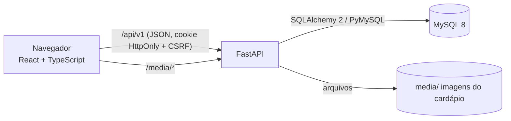
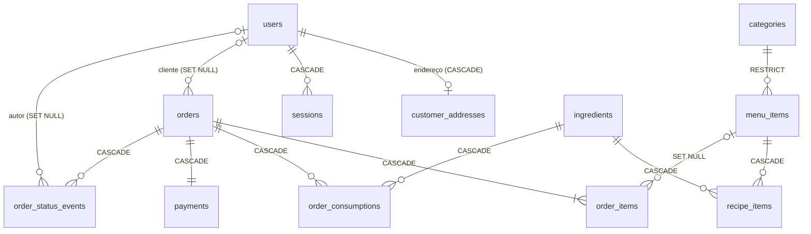

# 02 · Arquitetura

## Visão geral



- **Backend**: FastAPI síncrono (endpoints rodam no threadpool) + SQLAlchemy 2.x ORM + Alembic + Pydantic v2. Escolhido o modo síncrono porque o domínio é CRUD transacional com travas de linha (`SELECT … FOR UPDATE`); o driver assíncrono não traria ganho perceptível e complicaria as transações.
- **Frontend**: React 19 + TypeScript + Vite, Tailwind CSS v4, componentes no estilo shadcn/ui (Radix UI + `class-variance-authority`) escritos no próprio repositório, ícones Lucide, TanStack Query (cache e sincronização com a API), React Hook Form + Zod (formulários), Zustand (carrinho persistido no navegador), Sonner (toasts).
- **Banco**: MySQL 8 (InnoDB, `utf8mb4`), migrações Alembic versionadas. Testes rodam em um banco separado (`caliburger_test`).

## Estrutura de diretórios

```text
backend/
  app/
    main.py                 # cria a aplicação, middlewares, handlers, rotas
    core/                   # config, segurança, erros, logging, dependências
    db/                     # Base declarativa, engine/sessão, tipos
    modules/
      users/                # modelos e schemas de usuário (clientes e funcionários)
      auth/                 # login, logout, cadastro, sessão, limite de tentativas
      accounts/             # perfil do usuário logado, endereço, senha, exclusão
      staff/                # equipe (balconistas/cozinheiros)
      catalog/              # categorias, itens do cardápio, receitas, imagens
      inventory/            # ingredientes
      orders/               # criação, máquina de estados, listagem
      reports/              # relatório de vendas
      <módulo>/router.py    # HTTP: valida entrada, chama serviço, serializa saída
      <módulo>/schemas.py   # contratos Pydantic
      <módulo>/service.py   # regras de negócio + transações
      <módulo>/models.py    # tabelas SQLAlchemy
  alembic/                  # migrações
  scripts/                  # seed de demonstração e importação do banco legado
  tests/                    # unitários + integração (MySQL de teste)
frontend/
  src/
    api/                    # cliente HTTP (CSRF, erros), endpoints por domínio, chaves do cache
    app/                    # roteamento, providers, layouts, guards
    components/ui/          # design system (Button, Field, Dialog, ConfirmDialog, Table…)
    components/common.tsx   # componentes compartilhados (PageHeader, EmptyState, StatusBadge…)
    features/<domínio>/     # páginas e componentes por domínio (auth, menu, cart, checkout, orders, kitchen, catalog, inventory, reports, staff, profile)
    hooks/                  # hooks genéricos (debounce, relógio)
    lib/                    # formatação pt-BR, rótulos, validações (CPF), utilitários
    types/                  # contratos da API em TypeScript
docs/                       # auditoria, arquitetura, rastreabilidade, design system, decisões, migração
tools/                      # script de capturas de tela (Playwright)
```

Regra de dependência: `router → service → models/db`. Rotas não contêm SQL nem regra de negócio; serviços não conhecem HTTP (lançam exceções de domínio que a camada web converte em respostas).

## Modelo de dados



| Tabela | Destaques |
| --- | --- |
| `users` | `role` ∈ {customer, manager, cook}; `account_type` gerado (`customer`/`staff`); `UNIQUE(cpf, account_type)`; `username` único (clientes); `sex` (funcionários); `password_hash` bcrypt; `password_changed_at` |
| `customer_addresses` | 1:1 com o cliente (`state`, `city`, `district`, `street`) |
| `sessions` | `token_hash` (SHA-256) único, `expires_at`, `last_seen_at`; o token puro só existe no cookie |
| `login_attempts` | `key_hash` (IP + identificador), falhas e `locked_until` |
| `categories` | dados de referência (Lanches, Acompanhamentos, Bebidas) |
| `menu_items` | `CHECK price > 0`, `image_path` |
| `ingredients` | nome único, `CHECK quantity >= 0` |
| `recipe_items` | PK composta, `CHECK quantity > 0` |
| `orders` | `status` enum; `customer_name` congelado; `total`; `idempotency_key` com `UNIQUE(customer_id, idempotency_key)`; índices `(status, created_at)` e `(customer_id, created_at)`; `delivery_address` congelado |
| `order_items` | `product_name`, `unit_price`, `quantity`, `subtotal`, `notes` congelados |
| `order_consumptions` | consumo real por ingrediente (devolvido no cancelamento) |
| `payments` | método `pix`, valor, data |
| `order_status_events` | linha do tempo (de → para, autor, data) |

Datas em UTC (`DATETIME`), dinheiro em `DECIMAL(10,2)` manipulado como `Decimal` no Python.

**Estratégia de migração**: Alembic com migrações versionadas e revisadas manualmente (`alembic upgrade head`). O banco PHP original **não é alterado**: a importação é feita por `scripts/import_legacy.py`, que lê o banco legado (somente leitura) e grava no novo, com mapeamento documentado em [06-migracao-dados.md](06-migracao-dados.md).

## Contratos da API (`/api/v1`)

Documentação interativa gerada automaticamente em `/api/docs` (Swagger) e `/api/redoc`.

| Método | Rota | Perfil | Descrição |
| --- | --- | --- | --- |
| POST | `/auth/register` | público | cadastro de cliente |
| POST | `/auth/login` | público | `{identifier, password}` — usuário (cliente) ou CPF (funcionário) |
| POST | `/auth/logout` | logado | encerra a sessão |
| GET | `/auth/me` | logado | usuário da sessão |
| GET/PUT | `/me/profile` | logado | ver/editar os próprios dados |
| PUT | `/me/address` | cliente | endereço de entrega |
| POST | `/me/password` | logado | troca de senha (exige a atual) |
| DELETE | `/me` | cliente, balconista | exclui a própria conta |
| GET | `/categories` | público | categorias |
| GET | `/menu-items` | público | itens com disponibilidade (`?category_id`) |
| GET | `/menu-items/{id}` | balconista, cozinheiro | detalhe com receita |
| POST/PUT/DELETE | `/menu-items[/{id}]` | balconista | CRUD com receita |
| PUT/DELETE | `/menu-items/{id}/image` | balconista | enviar/substituir (multipart) ou remover a imagem |
| GET/POST | `/ingredients` | balconista | listar / adicionar (soma se existir) |
| PUT/DELETE | `/ingredients/{id}` | balconista | editar / excluir |
| POST | `/orders` | cliente | criar pedido (`Idempotency-Key`) |
| GET | `/orders` | todos os funcionários e cliente | lista paginada; escopo por perfil |
| GET | `/orders/summary` | balconista, cozinheiro | contagem por status (cozinha: só a fila) |
| GET | `/orders/{id}` | dono ou funcionário | detalhe + linha do tempo |
| POST | `/orders/{id}/actions/{action}` | conforme a máquina de estados | `accept`, `reject`, `dispatch`, `cancel`, `complete` |
| GET | `/reports/sales` | balconista | `?start=YYYY-MM-DD&end=YYYY-MM-DD` |
| GET/POST | `/staff` | balconista | listar / cadastrar funcionário |
| DELETE | `/staff/{id}` | balconista | excluir (não o último balconista) |
| GET | `/health` | público | verificação de saúde (inclui banco) |

**Formato de erro** (todas as respostas 4xx/5xx):

```json
{ "error": { "code": "insufficient_stock", "message": "Não há estoque suficiente para: Cali Duplo.", "fields": {} } }
```

`fields` traz erros por campo (`{"cpf": "CPF inválido."}`) para o frontend exibi-los junto ao input. Erros 500 nunca expõem detalhes internos (registrados no log com `request_id`).

## Autenticação e autorização

- **Sessão no servidor**: no login é gerado um token aleatório de 256 bits; o banco guarda apenas o SHA-256. O token vai em cookie `HttpOnly`, `SameSite=Lax`, `Secure` em produção, com expiração deslizante (padrão 12 h, máx. 7 dias).
- **CSRF** (double submit): o login também define um cookie legível `cb_csrf`; requisições `POST/PUT/PATCH/DELETE` precisam enviar o mesmo valor no cabeçalho `X-CSRF-Token`. O cliente HTTP do frontend faz isso automaticamente.
- **Revogação**: troca de senha encerra as outras sessões; exclusão de conta apaga todas.
- **Autorização** por dependência `require_roles(...)` em cada rota + verificação de propriedade nos serviços (ex.: cliente só acessa o próprio pedido; consultas sempre filtradas pelo `customer_id` da sessão).
- **Limite de tentativas**: 5 falhas em 5 min por IP + identificador bloqueiam por 5 min (persistido no banco, funciona com vários processos).
- **Senhas**: bcrypt (custo 12), compatível com os hashes `$2y$` do PHP — o importador preserva as senhas existentes.

## Erros e validação

- Pydantic valida formato (tamanhos, tipos, CPF, datas); serviços validam regras que dependem do banco (unicidade, estoque, transições).
- Exceções de domínio (`NotFound`, `Conflict`, `BusinessRuleError`, `Forbidden`, `Unauthorized`, `RateLimited`) → handler único.
- Frontend: Zod espelha as validações de formato (feedback imediato); erros de campo do servidor são aplicados ao formulário (`setError`); demais erros viram toast.

## Estratégia de testes

| Camada | Ferramenta | O que cobre |
| --- | --- | --- |
| Unitário | pytest | CPF, dinheiro, disponibilidade, máquina de estados, normalização do carrinho, hashing |
| Integração | pytest + TestClient + MySQL de teste | endpoints, permissões, transações, estoque, relatório, sessões, CSRF, upload |
| Migrações | pytest | `alembic upgrade head` em banco vazio + `downgrade base` + `upgrade` |
| Concorrência | pytest + threads | dois pedidos simultâneos pelo último ingrediente → só um passa |
| Importação | pytest | carrega o schema PHP original em um banco temporário e importa |
| Frontend (unitário) | Vitest + jsdom | carrinho (limites, sincronização, totais em centavos), CPF, formatação de moeda e datas, `safeNext`, cliente HTTP (CSRF, `ApiError`) |
| Frontend (componente) | Vitest + Testing Library + user-event | `ConfirmDialog` sem duplo envio enquanto a ação está pendente |
| Frontend (estático) | `tsc`, ESLint, build do Vite e verificação manual no navegador | tipos, lint, build, fluxos completos das telas |

Os testes **nunca** usam o banco de desenvolvimento: a URL de teste é exigida separadamente (`TEST_DATABASE_URL`) e o nome do banco precisa terminar em `_test`.

## Plano de implementação (executado nesta ordem)

1. Infraestrutura do backend: configuração, banco, Alembic, erros, logging, segurança.
2. Autenticação e contas (cadastro, login, sessão, perfil, senha, endereço, exclusão).
3. Catálogo + estoque (CRUD, receitas, disponibilidade, imagens).
4. Pedidos (criação transacional, máquina de estados, listagem paginada, histórico).
5. Relatório e equipe.
6. Seed de demonstração e importador do banco legado.
7. Frontend: design system → layouts e guards → telas por perfil.
8. Testes, revisão de segurança/acessibilidade, documentação e Docker.
